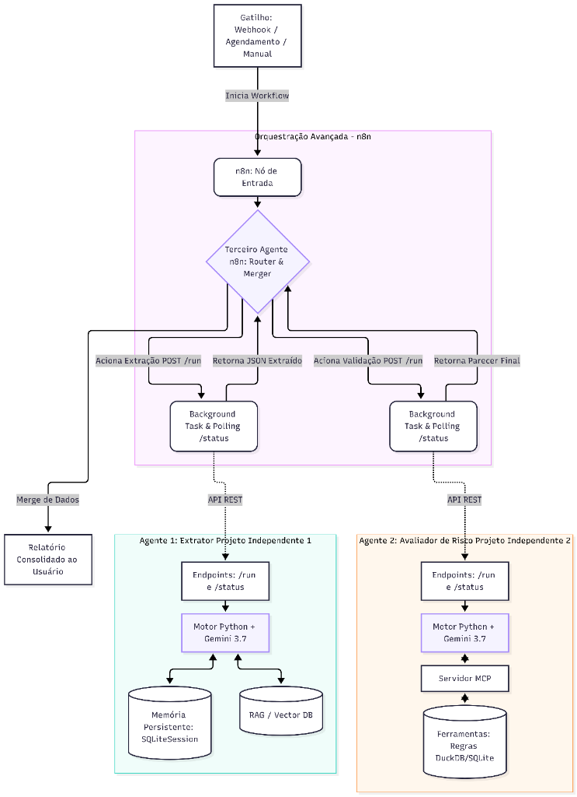

# Sistema Multi-Agente de Análise de Contratos

**Projeto de Bloco — Desenvolvimento de Agentes Inteligentes**  
**Repositório Oficial:** [github.com/MariaEduardaMendes/agente-analise-de-contratos](https://github.com/MariaEduardaMendes/agente-analise-de-contratos)  
**Status da Entrega:** Protótipo Funcional Validado (TP2)

---

## 📖 Visão Geral

Este projeto implementa um **ecossistema multi-agente autônomo** para auditoria jurídica e extração estruturada de contratos de tecnologia e inteligência artificial. O sistema evoluiu de um script simples com LLM para um agente corporativo funcional, dotado de:

1. **Ferramentas Externas (`@function_tool`):** Normalização temporal da vigência contratual (ISO-8601) e verificação matemática da consistência de parcelas e valor global.
2. **Pipelines de Raciocínio Encadeado:** Decomposição estrutural documental através de *Least-to-Most Prompting* e resolução factual passo a passo via *Chain-of-Thought (CoT)*.
3. **Memória Persistente em Duas Camadas:** Continuidade conversacional com `SQLiteSession` do OpenAI Agents SDK e recuperação semântica vetorial (RAG) de precedentes históricos com embeddings de 1536 dimensões (`text-embedding-3-small`).
4. **Saídas Fortemente Tipadas:** Validação estrutural de ponta a ponta com **Pydantic v2** (`DadosContratoExtraido`), combinando ferramentas Python e `output_type` no mesmo agente.
5. **Avaliação Sistemática de Prompts:** Benchmark comparativo de variantes (A/B) com métricas quantitativas e aplicação do ciclo *Prompt-Response-Reflect-Revise (PRRR)* (+400% no Índice Geral de Qualidade).

---

## 🎥 Vídeo de Demonstração (Pitch Técnico)

Confira a apresentação em vídeo (até 5 minutos) demonstrando o Agente 1 em execução e explicando as principais decisões técnicas, ferramentas de cálculo, persistência e validação:

- 🔗 **Link do Vídeo (YouTube):** [https://youtu.be/k16KZ5CjcuE](https://youtu.be/k16KZ5CjcuE)

---

## 🏛️ Arquitetura do Sistema (Os 9 Componentes)

O sistema opera sob orquestração de fluxos assíncronos no **n8n** conectando microsserviços em Python construídos com o **OpenAI Agents SDK**:



> Para detalhes completos dos 9 componentes, gatilhos, fontes de dados e diagrama de sequência, consulte [`diagrama.md`](diagrama.md) e o [`RELATORIO_TECNICO.md`](RELATORIO_TECNICO.md).

---

## 📁 Estrutura do Repositório

```text
PB/
├── agent/                                  # Código-fonte funcional do agente e demonstrações
│   ├── tools.py                            # Implementação das ferramentas (@function_tool)
│   ├── memoria_rag.py                      # SQLiteSession (SessionABC) e pipeline RAG com embeddings
│   ├── pipeline_raciocinio.py              # Execução encadeada (Least-to-Most + Chain-of-Thought)
│   ├── demo_saida_tipada.py                # Agente combinando tools + output_type (Pydantic v2)
│   ├── demo_memoria_rag.py                 # Demonstração de persistência entre runs e cross-session
│   ├── agente_extracao.py                  # Agente de extração inicial
│   ├── contrato_exemplo.txt                # Minuta contratual de teste (serviços de IA)
│   ├── banco_memoria_contratos.db          # Banco SQLite persistente (sessões e vetores)
│   ├── output_etapa1_decomposicao.json     # Output da Etapa 1 do pipeline encadeado
│   ├── output_etapa2_cot.json              # Output da Etapa 2 do pipeline encadeado
│   ├── resultado_pipeline_raciocinio.json  # Output final consolidado do pipeline
│   ├── parecer_auditoria_raciocinio.md     # Parecer executivo final gerado pelo agente
│   ├── registro_execucao_tool.json         # Log auditável da execução de tools
│   ├── registro_memoria_rag.json           # Evidência de continuidade e busca RAG
│   ├── resultado_saida_tipada.json         # JSON tipado validado via Pydantic
│   └── resultado_extracao.json             # Saída de extração integrada
│
├── prompts/                                # Prompts encadeados e documentação anatômica
│   ├── prompts_encadeados.md               # Sequência das etapas com outputs intermediários
│   ├── prompts_anatomia.md                 # Anatomia do prompt principal
│   ├── saidas_estruturadas.md              # Documentação das saídas estruturadas
│   ├── output_etapa1_decomposicao.json     # Cópia documentada da Etapa 1
│   ├── output_etapa2_cot.json              # Cópia documentada da Etapa 2
│   └── resultado_pipeline_raciocinio.json  # Cópia documentada do resultado final
│
├── evaluation/                             # Avaliação A/B e ciclo PRRR
│   ├── avaliacao_metricas_prompt.py        # Benchmark automatizado das métricas
│   ├── comparativo_variantes_prrr.md       # Análise comparativa e ciclo PRRR
│   └── resultado_avaliacao_metricas.json   # Relatório quantitativo medido (TCS, TIT, AFC, ARA, IGQ)
│
├── spec/                                   # Especificações técnicas e conceituais
│   ├── implementacao_ferramentas.md        # Especificação detalhada das tools
│   ├── pipeline_raciocinio_etapas.md       # Especificação do encadeamento Least-to-Most / CoT
│   ├── memoria_persistente_rag.md          # Especificação de SQLiteSession e RAG
│   ├── saidas_tipadas_pydantic.md          # Especificação da validação Pydantic v2
│   ├── avaliacao_metricas_prompts.md       # Especificação metodológica das métricas
│   └── especificacao_projeto.md            # Especificação arquitetural global
│
├── diagrama.md                             # Documento com a descrição dos 9 componentes e fluxo
├── diagrama.png                            # Imagem oficial da arquitetura do sistema
├── RELATORIO_TECNICO.md                    # Relatório técnico consolidado da entrega TP2
└── README.md                               # Este arquivo de documentação do repositório
```

---

## 🚀 Como Executar as Demonstrações

### Pré-requisitos
- Python 3.10+
- Ambiente virtual configurado com dependências do OpenAI Agents SDK e Pydantic v2:
  ```bash
  pip install openai-agents pydantic python-dotenv requests
  ```
- Variáveis de ambiente configuradas no arquivo `.env` (ex: chave de API do OpenRouter / OpenAI).

### Execução dos Componentes:

1. **Demonstração de Saída Tipada com Tools (`agent/demo_saida_tipada.py`):**
   ```bash
   python agent/demo_saida_tipada.py
   ```
   *Combina chamadas autônomas de tools (`normalizar_prazos_e_datas` e `extrair_e_validar_tabela_financeira`) com schema Pydantic `output_type=DadosContratoExtraido`.*

2. **Pipeline de Raciocínio Encadeado (`agent/pipeline_raciocinio.py`):**
   ```bash
   python agent/pipeline_raciocinio.py
   ```
   *Executa as 3 etapas de raciocínio encadeado (Least-to-Most + Chain-of-Thought) e gera os arquivos intermediários e o parecer final.*

3. **Memória de Sessão e Busca RAG (`agent/demo_memoria_rag.py`):**
   ```bash
   python agent/demo_memoria_rag.py
   ```
   *Demonstra a persistência de diretrizes entre runs distintos via `SQLiteSession` e recuperação de precedentes em sessão nova via RAG.*

4. **Benchmark de Avaliação e Ciclo PRRR (`evaluation/avaliacao_metricas_prompt.py`):**
   ```bash
   python evaluation/avaliacao_metricas_prompt.py
   ```
   *Mede o Índice Geral de Qualidade (IGQ) comparando a Variante A (Prompt Básico) e a Variante B (Estruturado + Tools).*
