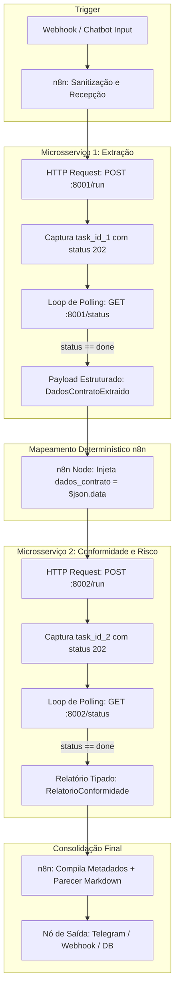

# Relatório Técnico Unificado de Evolução do Sistema Multi-Agente de Análise de Contratos

**Projeto de Bloco — Desenvolvimento de Agentes Inteligentes**  
**Autora:** Maria Eduarda Mendes  
**Repositório Oficial no GitHub:** [https://github.com/MariaEduardaMendes/agente-analise-de-contratos](https://github.com/MariaEduardaMendes/agente-analise-de-contratos)  
**Versão:** TP3 Consolidado (Microsserviços REST FastAPI, Context Engineering e Orquestração n8n)  
**Data:** 19/10/2026  
**Status:** Implementado, Testado e Homologado  

---

## 🧭 1. Visão Geral da Arquitetura e Evolução Histórica (TP1 ➔ TP2 ➔ TP3)

O projeto de análise e auditoria inteligente de contratos foi estruturado em um ciclo evolutivo rigoroso:

```
┌─────────────────────────┐     ┌─────────────────────────┐     ┌─────────────────────────┐
│           TP1           │ ──> │           TP2           │ ──> │           TP3           │
│   Script Python Básico  │     │  Agente com Ferramentas,│     │  Dois Microsserviços    │
│   e Extração Inicial    │     │  CoT, RAG e Pydantic v2 │     │  FastAPI, CLAUDE.md e   │
│   em Texto Livre        │     │  (OpenAI Agents SDK)    │     │  Workflow Inicial n8n   │
└─────────────────────────┘     └─────────────────────────┘     └─────────────────────────┘
```

1. **Fase TP1 (Componente Inicial):** Script Python elementar que consumia minutas contratuais e produzia JSONs simples, sujeito a alucinações de cálculo e vigência temporal relativa.
2. **Fase TP2 (Agente Inteligente e Funcional):**
   - Implementação de ferramentas Python determinísticas decoradas com `@function_tool` (cálculo de datas ISO-8601 e integridade de parcelas).
   - Decomposição de tarefas complexas através de *Least-to-Most Prompting* e raciocínio deliberativo (*Chain-of-Thought*).
   - Dupla camada de memória persistente: `SQLiteSession` para retenção de histórico conversacional e RAG vetorial com embeddings (`text-embedding-3-small`) para recuperação de precedentes.
   - Saídas fortemente tipadas com validação estrutural via **Pydantic v2**.
3. **Fase TP3 (Arquitetura Multi-Agente Desacoplada e Orquestração):**
   - **Agente 1 em Microsserviço REST:** Transformação do extrator em serviço HTTP com **FastAPI** e **`BackgroundTasks`**, respondendo `POST /run` com `202 Accepted` imediato e polling em `GET /status/{task_id}`.
   - **Segundo Agente Independente (Agente 2):** Implementação de um microsserviço isolado (`agent2/`) especializado em **Auditoria de Conformidade e Risco**, com suas próprias tools, Pydantic v2 e API FastAPI na porta `8002`.
   - **Context Engineering Descentralizado:** Arquivos `CLAUDE.md` exclusivos em cada pasta de agente (`agent1/CLAUDE.md` e `agent2/CLAUDE.md`), sem arquivos globais acoplados na raiz.
   - **Primeiro Workflow n8n:** Demonstração operacional de disparo assíncrono e captura de resposta via nó HTTP no n8n (`workflows/workflow_tp3_agente_extracao.json`).
   - **Consolidação Final do Pipeline de Prompts:** Avaliação quantitativa com 4 métricas, diagnóstico de prompts ineficazes e homologação da Variante V4.

---

## 🏛️ 2. Mapeamento da Estrutura de Pastas do Repositório

O repositório segue rigorosamente os padrões de desacoplamento de microsserviços exigidos:

```text
agente-analise-de-contratos/
├── RELATORIO_TECNICO.md            # Este Relatório Técnico Unificado Oficial
│
├── agent1/                         # PRIMEIRO AGENTE (Extrator Enriquecido de Contratos)
│   ├── CLAUDE.md                   # Contexto e regras exclusivas do Agente 1
│   ├── main.py                     # Microsserviço FastAPI (Porta 8001) com BackgroundTasks
│   ├── agente_extracao.py          # Pipeline central de extração estruturada
│   ├── tools.py                    # Ferramentas Python de normalização temporal e matemática
│   ├── models.py                   # Schemas Pydantic v2 (DadosContratoExtraido)
│   ├── memoria_rag.py              # Memória de sessão SQLite e RAG vetorial
│   ├── contrato_exemplo.txt        # Minuta jurídica de homologação
│   ├── test_api.py                 # Testes automatizados dos endpoints REST
│   └── requirements.txt            # Dependências específicas do Agente 1
│
├── agent2/                         # SEGUNDO AGENTE (Avaliador de Conformidade e Risco)
│   ├── CLAUDE.md                   # Contexto e regras exclusivas do Agente 2
│   ├── main.py                     # Microsserviço FastAPI (Porta 8002) com BackgroundTasks
│   ├── agente_auditoria.py         # Motor de auditoria contra regras corporativas
│   ├── tools.py                    # Ferramentas Python de checagem de alçadas e multas
│   ├── models.py                   # Schemas Pydantic v2 (RelatorioConformidade)
│   ├── test_api.py                 # Testes automatizados dos endpoints REST
│   └── requirements.txt            # Dependências específicas do Agente 2
│
├── workflows/                      # WORKFLOWS DO N8N
│   └── workflow_tp3_agente_extracao.json # Workflow oficial homologado no n8n
│
├── evaluation/                     # PIPELINE DE PROMPTS E AVALIAÇÃO
│   └── PIPELINE_PROMPTS_CONSOLIDADO.md # Benchmark, diagnóstico e decisão final técnica
│
├── integration/                    # CONTRATOS DE INTERFACE E APIS
│   └── contrato_api_agentes.md     # Especificação técnica dos endpoints, schemas e estados
│
└── docs/                           # DOCUMENTAÇÃO AUXILIAR
    ├── CONFIGURACAO_AMBIENTE.md    # Detalhamento do ambiente Antigravity + Claude Code
    └── screenshots/                # Evidências visuais de execução
```

---

## 💻 3. Configuração do Ambiente de Trabalho: Antigravity + Agente de Código

### 3.1 Alternativa Escolhida e Justificativa

Adotou-se a integração do **Antigravity IDE** integrado ao **Claude Code CLI** (v2.1.233) operando diretamente no terminal integrado PowerShell, com suporte de roteamento flexível via **9Router** para alocação eficiente de modelos de IA e tokens do plano Google AI Pro.

#### Justificativas Técnicas:
1. **Produtividade e Baixa Fricção:** O Antigravity unifica visualização de diffs, navegação na árvore de arquivos, visualização de diagramas Mermaid e controle de terminais integrados. O Claude Code atua diretamente no shell com acesso imediato ao contexto do projeto.
2. **Context Engineering Nativo:** A arquitetura do projeto utiliza arquivos `CLAUDE.md` dedicados por agente/diretório. O Claude Code lê automaticamente o `CLAUDE.md` do diretório em que é aberto, restringindo seu escopo às regras daquele microsserviço.
3. **Fluxo Sequencial e Seguro:** A interface de edição visual no Antigravity e a interação executiva no Claude Code evitam qualquer conflito de concorrência na escrita de arquivos.

### 3.2 Especificações do Ambiente

| Componente | Versão / Detalhes | Localização / Função |
| :--- | :--- | :--- |
| **IDE Principal** | Antigravity IDE (Windows 11) | Workspace `agente-analise-de-contratos` |
| **Agente de Código CLI** | Claude Code v2.1.233 | `C:\Users\dudap\AppData\Roaming\npm\claude.ps1` |
| **Roteador Opcional** | 9Router CLI (`localhost:20128`) | Proxy gateway intermediário para LLMs |
| **Modelo Ativo no 9Router** | `ag/gpt-oss-120b-medium` | LLM de alta fidelidade com suporte a raciocínio |
| **Python Runtime** | Python 3.14 (`.venv`) | FastAPI, Uvicorn, Pydantic v2, OpenAI Agents SDK |
| **Orquestrador de Workflows** | n8n (v1.x) em container Docker | Porta 5678 (`localhost:5678`) |

### 3.3 Variáveis de Ambiente Configuradas:
As variáveis de integração com o gateway local do 9Router são carregadas a partir do arquivo `.env`:

```powershell
$env:ANTHROPIC_BASE_URL = "http://localhost:20128/v1"
$env:ANTHROPIC_MODEL    = "ag/gpt-oss-120b-medium"
# ANTHROPIC_API_KEY gerenciada via .env
```

---

## 🔌 4. Documentação das APIs REST dos Dois Agentes

Ambos os agentes foram transformados em serviços HTTP padronizados usando **FastAPI** e **`BackgroundTasks`**, garantindo execução assíncrona não-bloqueante com o padrão **`202 Accepted`** e polling em `/status`.

```
┌────────────────────────────────────────────────────────────────────────┐
│                        ARQUITETURA DOS AGENTES                         │
│                                                                        │
│   ┌───────────────────────────────┐  ┌───────────────────────────────┐ │
│   │   Agente 1: Extrator (:8001)  │  │ Agente 2: Conformidade (:8002)│ │
│   │                               │  │                               │ │
│   │ • POST /run (202 Accepted)    │  │ • POST /run (202 Accepted)    │ │
│   │ • GET /status/{task_id}       │  │ • GET /status/{task_id}       │ │
│   │ • BackgroundTasks             │  │ • BackgroundTasks             │ │
│   │ • Schema: DadosContratoExtraido│ │ • Schema: RelatorioConformidade│
│   │ • Tools de Prazos e Finanças  │  │ • Tools de Multas e Alçadas   │ │
│   └───────────────────────────────┘  └───────────────────────────────┘ │
│                               ▲                      ▲                 │
│                               │                      │                 │
│                 Chamada HTTP  │                      │  Chamada HTTP   │
│                 desacoplada   │                      │  desacoplada    │
│                               └──────────┬───────────┘                 │
│                                          │                             │
│                         ┌────────────────┴────────────────┐            │
│                         │        n8n Orquestrador         │            │
│                         │     (Coordenação Externa)       │            │
│                         └─────────────────────────────────┘            │
└────────────────────────────────────────────────────────────────────────┘
```

### 4.1 Agente 1: Extrator Enriquecido de Contratos (Porta `8001`)

- **Responsabilidade:** Extração de metadados factuais (partes, objeto, prazos, valores, penalidades) com ferramentas Python determinísticas.
- **Ferramentas Nativas (`tools.py`):**
  - `normalizar_prazos_e_datas`: Converte datas para ISO-8601 (`YYYY-MM-DD`), calcula prazo de término somando meses de vigência e apura dias corridos e prazo de aviso prévio.
  - `extrair_e_validar_tabela_financeira`: Multiplica parcelas por valor unitário, confronta com o total e calcula discrepâncias centesimais.

#### Especificação dos Endpoints — Agente 1:
- **`POST /run`:**
  - **Status:** `202 Accepted`
  - **Entrada (JSON):** `{"texto_contrato": "Texto integral da minuta..."}`
  - **Saída Imediata (JSON):**
    ```json
    {
      "task_id": "ca1bae57-cb6d-4451-8778-d4b2326ebbca",
      "status": "pending",
      "message": "Processamento de extração iniciado com sucesso em segundo plano."
    }
    ```
- **`GET /status/{task_id}`:**
  - **Status:** `200 OK` (ou `404 Not Found` se `task_id` inexistente)
  - **Estados:** `pending`, `done`, `error`.
  - **Saída Concluída (JSON):**
    ```json
    {
      "task_id": "ca1bae57-cb6d-4451-8778-d4b2326ebbca",
      "status": "done",
      "created_at": 1792438112.03,
      "completed_at": 1792438112.04,
      "data": {
        "titulo": "Contrato de Prestação de Serviços de Desenvolvimento de Inteligência Artificial",
        "contratante": { "nome": "Empresa Contratante S.A.", "cnpj_cpf": "98.765.432/0001-10", "papel": "CONTRATANTE" },
        "contratada": { "nome": "TechSolutions Ltda.", "cnpj_cpf": "12.345.678/0001-90", "papel": "CONTRATADA" },
        "objeto": "Desenvolvimento, homologação e implantação de agentes inteligentes integrados a sistemas legados.",
        "financeiro": {
          "moeda": "BRL", "valor_total_brl": 120000.0, "parcelas_quantidade": 12, "valor_parcela_brl": 10000.0,
          "periodicidade": "mensal", "soma_consistente": true, "discrepancia_centavos": 0.0,
          "cronograma_resumo": "12 parcelas de R$ 10,000.00 (mensal)"
        },
        "vigencia": {
          "data_inicio_iso": "2026-01-15", "data_fim_calculada_iso": "2027-01-15",
          "vigencia_meses": 12, "dias_corridos_totais": 365, "aviso_previo_dias": 30,
          "vigencia_formatada": "De 2026-01-15 a 2027-01-15 (12 meses / 365 dias)"
        },
        "penalidades": {
          "percentual_multa_rescisoria": 20.0, "base_calculo": "saldo remanescente do contrato",
          "gatilho_aplicacao": "rescisao_imotivada_sem_justa_causa"
        },
        "secoes_analisadas": ["PREAMBULO", "OBJETO", "PRECO_E_CONDICOES", "VIGENCIA", "RESCISAO_E_PENALIDADES"]
      },
      "error": null
    }
    ```

---

### 4.2 Agente 2: Avaliador de Conformidade e Risco (Porta `8002`)

- **Responsabilidade:** Receber o JSON estruturado emitido pelo Agente 1 (via n8n), confrontar as cláusulas contra a base de governança corporativa, calcular score de conformidade e emitir parecer executivo tipado.
- **Ferramentas Nativas (`tools.py`):**
  - `auditar_parametros_contratuais_fn`: Confronta o percentual de multa com o teto padrão de 10%, audita a alçada de aprovação gerencial (teto de R$ 100.000,00 — acima exige ratificação da Diretoria) e verifica o aviso prévio mínimo (30 dias).
  - `consultar_base_regras_negocio_fn`: Fornece a matriz de diretrizes corporativas vigentes.

#### Especificação dos Endpoints — Agente 2:
- **`POST /run`:**
  - **Status:** `202 Accepted`
  - **Entrada (JSON):** `{"dados_contrato": {...}}` (payload gerado pelo Agente 1)
  - **Saída Imediata (JSON):**
    ```json
    {
      "task_id": "d6b391b8-3895-4388-a3dc-0e7e426d30bc",
      "status": "pending",
      "message": "Auditoria de conformidade iniciada com sucesso em segundo plano."
    }
    ```
- **`GET /status/{task_id}`:**
  - **Status:** `200 OK` (ou `404 Not Found` se `task_id` inexistente)
  - **Saída Concluída (JSON):**
    ```json
    {
      "task_id": "d6b391b8-3895-4388-a3dc-0e7e426d30bc",
      "status": "done",
      "created_at": 1792438113.58,
      "completed_at": 1792438113.58,
      "data": {
        "contrato_titulo": "Contrato de Prestação de Serviços de Desenvolvimento de Inteligência Artificial",
        "score_conformidade": 73.33,
        "nivel_risco_geral": "MEDIO",
        "total_regras_auditadas": 3,
        "itens_conformes": 1,
        "itens_alerta": 2,
        "itens_nao_conformes": 0,
        "itens_auditados": [
          {
            "regra": "Teto de Multa Rescisória",
            "status": "ALERTA",
            "nivel_risco": "MEDIO",
            "descricao_analise": "Multa rescisória fixada em 20.0%, superando a diretriz de governança recomendada de até 10.0%...",
            "fundamentacao": "Política Interna de Riscos Contratuais (Cap. IV, Art. 12)..."
          },
          {
            "regra": "Alçada de Aprovação Financeira",
            "status": "ALERTA",
            "nivel_risco": "ALTO",
            "descricao_analise": "Valor global do contrato (R$ 120,000.00) excede a alçada gerencial (R$ 100,000.00)...",
            "fundamentacao": "Manual de Alçadas e Governança Financeira - Alçada Nível 1."
          },
          {
            "regra": "Prazo Mínimo de Aviso Prévio",
            "status": "CONFORME",
            "nivel_risco": "BAIXO",
            "descricao_analise": "Aviso prévio pactuado (30 dias) atende integralmente ao requisito de segurança.",
            "fundamentacao": "Diretriz Operacional de Continuidade de Negócios."
          }
        ],
        "recomendacoes_mitigacao": [
          "Negociar redução da cláusula penal para o patamar padrão de até 10%.",
          "Submeter o contrato à assinatura conjunta da Diretoria Executiva."
        ],
        "parecer_executivo_markdown": "# Parecer de Conformidade e Risco Contratual..."
      },
      "error": null
    }
    ```

---

## 📑 5. Governança e Context Engineering com `CLAUDE.md` por Agente

Para impedir o acoplamento monolítico, **foi removido qualquer arquivo `CLAUDE.md` centralizado na raiz**. Cada agente possui seu próprio arquivo com diretrizes exclusivas:

### 5.1 [`agent1/CLAUDE.md`](agent1/CLAUDE.md) — Agente 1 (Extração)
- **Fronteira Estrita (*Boundary Enforcement*):** O Agente 1 é proibido de emitir juízos de risco ou pareceres de conformidade corporativa. Seu escopo é 100% factual e matemático.
- **Modelagem Tipada:** Define o schema Pydantic v2 `DadosContratoExtraido`.
- **Instruções Operacionais:** Comandos para rodar o Uvicorn na porta 8001 e executar `test_api.py`.

### 5.2 [`agent2/CLAUDE.md`](agent2/CLAUDE.md) — Agente 2 (Conformidade)
- **Fronteira Estrita (*Boundary Enforcement*):** O Agente 2 é proibido de fazer parsing de texto bruto ou invocar o Agente 1 diretamente. Opera unicamente sobre os dados estruturados entregues pelo orquestrador.
- **Modelagem Tipada:** Define o schema Pydantic v2 `RelatorioConformidade` com checagem quantitativa estrita (`@model_validator`).
- **Instruções Operacionais:** Comandos para rodar o Uvicorn na porta 8002 e executar `test_api.py`.

---

## 🔬 6. Consolidação Definitiva do Pipeline de Prompts e Avaliação

O documento formal [`evaluation/PIPELINE_PROMPTS_CONSOLIDADO.md`](evaluation/PIPELINE_PROMPTS_CONSOLIDADO.md) encerra o ciclo de refinamento de prompts do projeto.

### 6.1 Critérios de Avaliação e Métricas

| Métrica | Sigla | Peso | Critério Avaliado |
| :--- | :---: | :---: | :--- |
| **Taxa de Conformidade de Schema** | **TCS** | **30%** | Validação estrita perante os schemas Pydantic v2. |
| **Taxa de Invocação de Tools** | **TIT** | **30%** | Chamada mandante a funções determinísticas em Python. |
| **Acurácia Factual de Entidades** | **AFC** | **20%** | Exatidão de nomes, CNPJs, valores e cláusulas extraídas. |
| **Acurácia de Sanitização e Cálculo** | **ASC** | **20%** | Resolução correta no calendário ISO-8601 e soma de parcelas. |

$$\text{IGQ} = (0.30 \times \text{TCS}) + (0.30 \times \text{TIT}) + (0.20 \times \text{AFC}) + (0.20 \times \text{ASC})$$

### 6.2 Matriz Evolutiva das Variantes Testadas

| Métrica | V1 (Monolítico / Zero-Shot) | V2 (Anatômico com Few-Shot) | V3 (CoT Encadeado) | V4 Definitiva (Tools + Pydantic v2) |
| :--- | :---: | :---: | :---: | :---: |
| **TCS** (Conformidade de Schema) | `0.00` | `0.60` | `0.85` | **`1.00`** |
| **TIT** (Invocação de Ferramentas) | `0.00` | `0.00` | `0.50` | **`1.00`** |
| **AFC** (Acurácia Factual) | `0.50` | `0.80` | `0.95` | **`1.00`** |
| **ASC** (Sanitização e Cálculo) | `0.00` | `0.20` | `0.70` | **`1.00`** |
| **Índice Geral de Qualidade (IGQ)** | **`0.150`** | **`0.440`** | **`0.785`** | **`1.000` (+566%)** |

### 6.3 Diagnóstico de Prompts Ineficazes e Correções

1. **Ambiguidade de Formato e Datas Relativas:**
   - *Falha:* Repetição discursiva de datas relativas como `"12 meses a partir de 15/01/2026"`.
   - *Correção:* Imposição de schema estrito e delegação à tool `normalizar_prazos_e_datas` (`2027-01-15`, 365 dias corridos).
2. **Ilusão Aritmética (*Arithmetic Hallucination*):**
   - *Falha:* O modelo errava a multiplicação de parcelas fracionadas e atestava falsamente consistência matemática sem validar centavos.
   - *Correção:* Proibição de cálculo mental no prompt e delegação mandatória para a tool `@function_tool extrair_e_validar_tabela_financeira`.
3. **Vazamento de Escopo (*Scope Bleed*):**
   - *Falha:* O Agente 1 começava a julgar riscos e emitir opiniões sobre cláusulas penais abusivas, quebrando a separação de microsserviços.
   - *Correção:* Imposição de *Boundary Enforcement* explícito no prompt do sistema: *"NÃO emita julgamentos de risco ou conformidade; essa competência pertence ao Agente 2"*.

---

## 🔄 7. Primeiro Workflow n8n e Orquestração Futura (TP4)

### 7.1 Workflow n8n Homologado ([`workflows/workflow_tp3_agente_extracao.json`](workflows/workflow_tp3_agente_extracao.json))

Construído, executado e exportado diretamente no n8n:
1. **Trigger Manual (`When clicking ‘Execute workflow’`):** Ponto de disparo para execução sob demanda.
2. **Nó `HTTP Request` (`POST /run`):** Envia a minuta para `http://172.17.0.1:8001/run` e recebe imediatamente `202 Accepted` com `task_id` e status `pending`.
3. **Nó `Wait`:** Pausa de 2 segundos para o processamento assíncrono.
4. **Nó `HTTP Request1` (`GET /status/{task_id}`):** Consulta `http://172.17.0.1:8001/status/{{ $json.task_id }}` e captura o JSON tipado com os dados extraídos (`DadosContratoExtraido`).

### 7.2 Orquestração Multi-Agente no TP4

No **TP4**, o n8n assumirá o papel de orquestrador determinístico completo através do padrão **Saga / Polling Assíncrono**, conectando os dois agentes de ponta a ponta sem qualquer acoplamento de código direto:



---

## 🏆 8. Checklist Consolidado de Entregáveis

| Entregável | Localização no Repositório | Status |
| :--- | :--- | :---: |
| **Código do Agente 1 (FastAPI + BackgroundTasks)** | [`agent1/`](agent1/) | ✅ Homologado |
| **CLAUDE.md do Agente 1 (Context Engineering)** | [`agent1/CLAUDE.md`](agent1/CLAUDE.md) | ✅ Concluído |
| **Código do Agente 2 (FastAPI + Tools + Pydantic v2)** | [`agent2/`](agent2/) | ✅ Homologado |
| **CLAUDE.md do Agente 2 (Context Engineering)** | [`agent2/CLAUDE.md`](agent2/CLAUDE.md) | ✅ Concluído |
| **Workflow n8n Exportado em JSON** | [`workflows/workflow_tp3_agente_extracao.json`](workflows/workflow_tp3_agente_extracao.json) | ✅ Exportado |
| **Avaliação Final do Pipeline de Prompts** | [`evaluation/PIPELINE_PROMPTS_CONSOLIDADO.md`](evaluation/PIPELINE_PROMPTS_CONSOLIDADO.md) | ✅ Concluído |
| **Contrato de API dos Dois Agentes** | [`integration/contrato_api_agentes.md`](integration/contrato_api_agentes.md) | ✅ Documentado |
| **Relatório Técnico Unificado** | [`RELATORIO_TECNICO.md`](RELATORIO_TECNICO.md) | ✅ Finalizado |
| **Link do Repositório GitHub** | [MariaEduardaMendes/agente-analise-de-contratos](https://github.com/MariaEduardaMendes/agente-analise-de-contratos) | ✅ Disponível |
