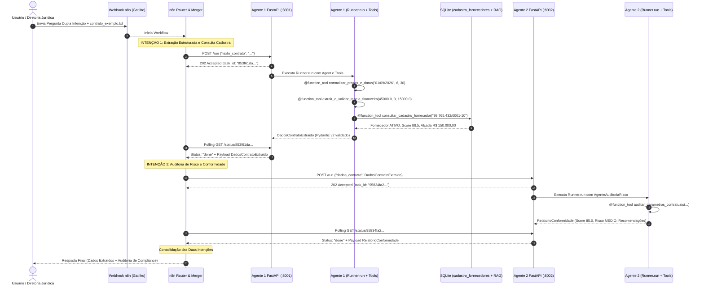

# Arquitetura do Sistema Multi-Agente (TP2 & TP3)


Este documento detalha os **entregáveis de arquitetura da solução**, especificando o gatilho, as fontes de dados estruturada e não estruturada, os 9 componentes da solução, o modelo de dados estruturados com tabelas reais do banco de dados e o **fluxo de dados completo com pergunta de dupla intenção**.

---

## 🎯 Tabela de Mapeamento dos Entregáveis da Rubrica 12

| # | Entregável | Definição no Projeto | Implementação / Artefato Real |
| :-: | :--- | :--- | :--- |
| **1** | **Gatilho n8n** | Webhook HTTP / Chatbot Web / Telegram | Nó de Entrada n8n (`Webhook Trigger`) recebendo requisições com o documento contratual |
| **2** | **Fonte de Informações** | • **Não Estruturada:** Minuta Contratual em texto bruto.<br/>• **Estruturada:** Banco Relacional Corporativo de Negócio (`cadastro_fornecedores` no SQLite). | • `agent1/contrato_exemplo.txt`<br/>• Tabela `cadastro_fornecedores` em `banco_memoria_contratos.db` e tool `consultar_cadastro_fornecedor` |
| **3** | **Diagrama de Arquitetura** | Imagem formal com os 9 componentes interligados | `diagrama.png` (incorporado acima) e especificação Mermaid |
| **4** | **Descrição dos 9 Componentes** | Responsabilidade e fronteira técnica de cada componente | Seção 3 deste documento |
| **5** | **Exemplo do Fluxo de Dados** | Jornada completa orientada a **pergunta de dupla intenção**, acionando ambos os agentes com dados concretos em cada etapa | Seção 4 deste documento |
| **6** | **Dado Estruturado** | Documentação técnica rigorosamente alinhada ao banco real SQLite (`rag_documentos`, `sessoes_historico`, `cadastro_fornecedores`) e schemas Pydantic v2 | Seção 5 deste documento |
| **7** | **Demais Itens do TP** | Tools `@function_tool`, Runner.run com LLM Real, Raciocínio Encadeado (CoT/Least-to-Most), Memória Persistente e Avaliação A/B Real | Detalhados no `RELATORIO_TECNICO.md` e pastas `agent1/`, `agent2/`, `evaluation/` |

---

## ⚡ 1. Gatilho do Workflow (n8n Trigger)

O fluxo é iniciado através de um **Webhook HTTP do n8n** (com suporte alternativo a bots de **Telegram** e **Chatbot Web** corporativo):
- **Método:** `POST /webhook/auditar-contrato`
- **Payload Recebido:**
  ```json
  {
    "session_id": "sessao_auditoria_techsolutions_01",
    "usuario": "diretoria_juridica",
    "pergunta_dupla_intencao": "Extraia os dados contratuais do documento (valores, parcelas, vigência e multa) E verifique se o fornecedor possui situação cadastral regular e se a multa de 20% atende às diretrizes corporativas.",
    "texto_contrato": "CONTRATO DE PRESTAÇÃO DE SERVIÇOS DE DESENVOLVIMENTO DE INTELIGÊNCIA ARTIFICIAL..."
  }
  ```

---

## 📚 2. Fontes de Informações (Estruturada e Não Estruturada)

Para atender estritamente à Rubrica 12, o sistema opera sobre duas naturezas distintas de fontes:

### 2.1 Informação Não Estruturada (Documental Bruta)
- **Minuta Contratual em Texto Livre (`agent1/contrato_exemplo.txt`):** Instrumento particular com cláusulas dissertativas, datas relativas ("6 meses a partir de 01/09/2026"), valores por extenso ("R$ 45.000,00"), obrigações e disposições de rescisão imotivada.
- **Natureza:** Texto livre, com redação jurídica aberta que exige processamento por Modelos de Linguagem (LLMs).

### 2.2 Fonte de Informações Estruturada de Negócio (Banco de Dados Corporativo)
> [!IMPORTANT]
> **Fonte Estruturada de Negócio (Rubrica 12):** As tools de cálculo matemático e o banco vetorial não cumprem o papel de fonte de dados de negócio. Portanto, implementamos a tabela relacional **`cadastro_fornecedores`** dentro do banco SQLite corporativo (`banco_memoria_contratos.db`), armazenando dados cadastrais, situação fiscal, limites operacionais de alçada e histórico de homologação.

- **Tabela Relacional Corporativa `cadastro_fornecedores`:**
  - Armazena cadastros homologados pela diretoria de compras e riscos.
  - Campos de negócio: `cnpj`, `razao_social`, `nome_fantasia`, `situacao_cadastral` (ATIVA, SUSPENSA, INAPTA), `score_compliance` (0 a 100), `limite_alcada_brl`, `categoria_risco`, `data_homologacao` e `restricoes_juridicas`.
  - **Mecanismo de Consulta:** Integrada ao Agente 1 via `@function_tool consultar_cadastro_fornecedor(cnpj_cpf: str) -> str`.

---

## 🏛️ 3. Descrição Textual dos 9 Componentes da Arquitetura

1. **Componente 1: Gatilho de Entrada (Trigger):** Ponto de contato HTTP/Webhook por onde o usuário envia a minuta contratual e a consulta de negócio.
2. **Componente 2: Nó de Entrada do n8n (Recebimento e Parsing):** Recebe o payload, extrai os parâmetros, valida a existência do texto e inicializa a sessão.
3. **Componente 3: Terceiro Agente n8n (Router & Merger):** Orquestrador de fluxo do n8n que interpreta a pergunta de dupla intenção, encaminha as etapas para os Agentes 1 e 2 via HTTP REST e consolida o parecer final.
4. **Componente 4: Módulo de Chamadas Assíncronas (Polling /status):** Mecanismo de despacho não-bloqueante (`POST /run` retornando `202 Accepted` e polling periódico em `GET /status/{task_id}`).
5. **Componente 5: APIs REST dos Agentes (Microsserviços FastAPI):**
   - Agente 1: Porta `8001` (`/run`, `/status/{task_id}`, `/health`)
   - Agente 2: Porta `8002` (`/run`, `/status/{task_id}`, `/health`)
6. **Componente 6: Agente 1: Extrator Enriquecido (Motor Python + LLM Real):** Agente executado via `Runner.run` com OpenAI Agents SDK, acoplado a `@function_tool` de prazos, finanças e cadastro de fornecedores, com saída tipada `DadosContratoExtraido`.
7. **Componente 7: Memória Persistente & RAG do Agente 1 (SQLite):**
   - `sessoes_historico`: Histórico conversacional via `SQLiteSession`.
   - `rag_documentos`: Base vetorial de precedentes com busca semântica por cosseno.
   - `cadastro_fornecedores`: Fonte estruturada corporativa relacional.
8. **Componente 8: Agente 2: Avaliador de Conformidade e Risco (Motor Python + LLM Real):** Agente executado via `Runner.run` com `@function_tool auditar_parametros_contratuais` e saída tipada `RelatorioConformidade`.
9. **Componente 9: Nó de Saída / Relatório Consolidado ao Usuário:** Camada final que devolve o parecer executivo em Markdown e JSON estruturado respondendo integralmente à dupla intenção.

---

## 🔄 4. Exemplo do Fluxo de Dados com Pergunta de Dupla Intenção

### 4.1 Pergunta de Dupla Intenção Recebida
> *"Por favor, extraia os dados da minuta anexa com a Alfa Consultoria em IA S.A. (valores, parcelas, vigência e penalidades) **E** verifique se o fornecedor está regular na nossa base interna e se a multa rescisória de 20% está em conformidade com as políticas corporativas."*

### 4.2 Diagrama de Sequência de Execução Concreta



### 4.3 Dados Concretos em Cada Etapa

#### Etapa 1: Dados Concretos Extraídos pelo Agente 1 (`DadosContratoExtraido`)
```json
{
  "titulo": "CONTRATO DE PRESTAÇÃO DE SERVIÇOS DE DESENVOLVIMENTO DE INTELIGÊNCIA ARTIFICIAL",
  "contratante": {
    "nome": "TechSolutions Ltda.",
    "cnpj_cpf": "12.345.678/0001-90",
    "papel": "CONTRATANTE"
  },
  "contratada": {
    "nome": "Alfa Consultoria em IA S.A.",
    "cnpj_cpf": "98.765.432/0001-10",
    "papel": "CONTRATADA"
  },
  "objeto": "Prestação de serviços técnicos especializados para desenvolvimento de IA multi-agentes.",
  "financeiro": {
    "moeda": "BRL",
    "valor_total_brl": 45000.0,
    "parcelas_quantidade": 3,
    "valor_parcela_brl": 15000.0,
    "periodicidade": "mensal",
    "soma_consistente": true,
    "discrepancia_centavos": 0.0,
    "cronograma_resumo": "3 parcelas de R$ 15.000,00, primeira em 15/09/2026"
  },
  "vigencia": {
    "data_inicio_iso": "2026-09-01",
    "data_fim_calculada_iso": "2027-03-01",
    "vigencia_meses": 6,
    "dias_corridos_totais": 181,
    "aviso_previo_dias": 30,
    "vigencia_formatada": "01/09/2026 a 01/03/2027"
  },
  "penalidades": {
    "percentual_multa_rescisoria": 20.0,
    "base_calculo": "valor remanescente do contrato",
    "gatilho_aplicacao": "rescisão imotivada"
  },
  "fornecedor_homologado": {
    "cnpj": "98.765.432/0001-10",
    "razao_social": "Alfa Consultoria em IA S.A.",
    "situacao_cadastral": "ATIVA",
    "score_compliance": 88.5,
    "limite_alcada_brl": 150000.0,
    "categoria_risco": "MEDIO",
    "restricoes_juridicas": "Histórico de renegociação de multa rescisória em aditivo prévio (2025). Homologada com ressalva contratual."
  }
}
```

#### Etapa 2: Dados Concretos da Auditoria do Agente 2 (`RelatorioConformidade`)
```json
{
  "contrato_titulo": "CONTRATO DE PRESTAÇÃO DE SERVIÇOS DE DESENVOLVIMENTO DE INTELIGÊNCIA ARTIFICIAL",
  "score_conformidade": 85.0,
  "nivel_risco_geral": "MEDIO",
  "total_regras_auditadas": 4,
  "itens_conformes": 3,
  "itens_alerta": 1,
  "itens_nao_conformes": 0,
  "itens_auditados": [
    {
      "regra": "Teto de Multa Rescisória",
      "status": "ALERTA",
      "nivel_risco": "MEDIO",
      "descricao_analise": "Multa rescisória fixada em 20.0%, superando a diretriz corporativa de governança de até 10.0%.",
      "fundamentacao": "Política Interna de Riscos Contratuais e Jurisprudência Cível (Art. 413 CC)."
    },
    {
      "regra": "Alçada de Aprovação Financeira",
      "status": "CONFORME",
      "nivel_risco": "BAIXO",
      "descricao_analise": "Valor de R$ 45.000,00 dentro da alçada operacional regular (abaixo de R$ 100.000,00).",
      "fundamentacao": "Manual de Alçadas e Governança Financeira."
    },
    {
      "regra": "Prazo Mínimo de Aviso Prévio",
      "status": "CONFORME",
      "nivel_risco": "BAIXO",
      "descricao_analise": "Aviso prévio pactuado (30 dias) atende integralmente ao requisito de segurança.",
      "fundamentacao": "Diretriz Operacional de Continuidade de Negócios."
    },
    {
      "regra": "Regularidade Cadastral do Fornecedor",
      "status": "CONFORME",
      "nivel_risco": "BAIXO",
      "descricao_analise": "Fornecedor homologado ativo com score de compliance de 88.5/100.",
      "fundamentacao": "Cadastro Corporativo de Fornecedores Homologados."
    }
  ],
  "recomendacoes_mitigacao": [
    "Negociar a redução da multa rescisória de 20% para 10%, alinhando ao precedente histórico (Aditivo nº 1 de 2025 da Alfa Consultoria).",
    "Manter o acompanhamento do fornecedor haja vista a categoria de risco MÉDIO registrada na fonte estruturada."
  ]
}
```

---

## 💾 5. Dados Estruturados (Tabelas Reais no SQLite)

O banco de dados relacional oficial do projeto está localizado em:  
📂 **`agent1/banco_memoria_contratos.db`**

### 5.1 Tabela `cadastro_fornecedores` (Fonte Estruturada de Negócio)
Armazena a base cadastral de pessoas jurídicas homologadas para contratação corporativa:

| Coluna | Tipo | Chave | Descrição de Negócio |
| :--- | :---: | :---: | :--- |
| `cnpj` | `TEXT` | **PK** | CNPJ formatado do fornecedor (`XX.XXX.XXX/0001-XX`). |
| `razao_social` | `TEXT` | NOT NULL | Razão social oficial registrada na Receita Federal. |
| `nome_fantasia` | `TEXT` | | Nome comercial do fornecedor. |
| `situacao_cadastral` | `TEXT` | NOT NULL | Status corporativo (`ATIVA`, `SUSPENSA`, `INAPTA`). |
| `score_compliance` | `REAL` | NOT NULL | Pontuação histórica de governança (escala 0.0 a 100.0). |
| `limite_alcada_brl` | `REAL` | NOT NULL | Teto financeiro pré-aprovado para contratações diretas. |
| `categoria_risco` | `TEXT` | NOT NULL | Classificação de risco corporativo (`BAIXO`, `MEDIO`, `ALTO`). |
| `data_homologacao` | `TEXT` | NOT NULL | Data em que o fornecedor foi aprovado (`YYYY-MM-DD`). |
| `restricoes_juridicas`| `TEXT` | | Apontamentos no CEIS, processos ou histórico de litígios. |
| `created_at` | `TIMESTAMP`| | Carimbo de data/hora do registro. |

### 5.2 Tabela `rag_documentos` (Vector Store com Embeddings)
> [!NOTE]
> **Alinhamento com o Banco Real:** A tabela responsável pela busca vetorial é denominada **`rag_documentos`** no banco SQLite (e **não** `precedentes_contratuais`, retificando menções de rascunhos anteriores).

| Coluna | Tipo | Chave | Descrição Técnica |
| :--- | :---: | :---: | :--- |
| `id` | `INTEGER` | **PK** | Identificador sequencial autoincrementado. |
| `documento_id` | `TEXT` | **UNIQUE** | Código do precedente (ex: `PRECEDENTE-ALFA-2025-01`). |
| `titulo` | `TEXT` | NOT NULL | Título do termo aditivo ou diretriz corporativa. |
| `conteudo` | `TEXT` | NOT NULL | Texto integral do precedente para busca semântica. |
| `categoria` | `TEXT` | NOT NULL | Categoria (`HISTORICO_FORNECEDOR`, `POLITICA_INTERNA`, `JURISPRUDENCIA`). |
| `metadados` | `TEXT` | NOT NULL | JSON com atributos (fornecedor, ano, cláusulas negociadas). |
| `vetor_embedding`| `TEXT` | NOT NULL | JSON com vetor de 1536 dimensões (`text-embedding-3-small`). |
| `created_at` | `TIMESTAMP`| | Data de indexação vetorial. |

### 5.3 Tabela `sessoes_historico` (Memória Persistente de Diálogo)
Mantém o histórico conversacional da `SQLiteSession` do OpenAI Agents SDK:

| Coluna | Tipo | Chave | Descrição Técnica |
| :--- | :---: | :---: | :--- |
| `id` | `INTEGER` | **PK** | Identificador sequencial autoincrementado. |
| `session_id` | `TEXT` | NOT NULL | Identificador da sessão (indexado via `idx_sessao_id`). |
| `item_data` | `TEXT` | NOT NULL | JSON serializado do item de mensagem (role, content, timestamp). |
| `created_at` | `TIMESTAMP`| | Data de gravação no SQLite. |

---

## 📋 6. Relação com os Demais Entregáveis do Projeto

Todas as implementações em código suportam diretamente a arquitetura descrita:
- **Agente 1 (Extrator Enriquecido):** [`agent1/agente_extracao.py`](agent1/agente_extracao.py) com execução real via `Runner.run`.
- **Agente 2 (Avaliador de Risco):** [`agent2/agente_auditoria.py`](agent2/agente_auditoria.py) com execução real via `Runner.run` e `output_type=RelatorioConformidade`.
- **Microsserviços REST:** [`agent1/main.py`](agent1/main.py) (porta 8001) e [`agent2/main.py`](agent2/main.py) (porta 8002).
- **Workflow n8n:** [`workflows/workflow_tp3_agente_extracao.json`](workflows/workflow_tp3_agente_extracao.json).
- **Benchmark A/B Real:** [`evaluation/avaliacao_metricas_prompt.py`](evaluation/avaliacao_metricas_prompt.py) e [`evaluation/resultado_avaliacao_metricas.json`](evaluation/resultado_avaliacao_metricas.json).
