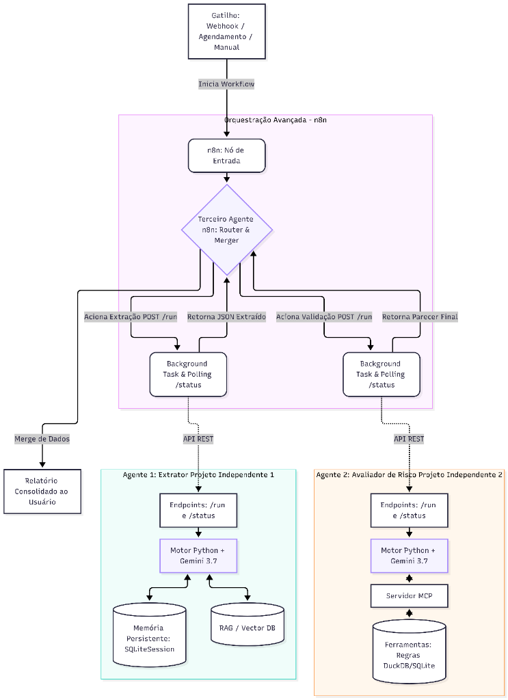
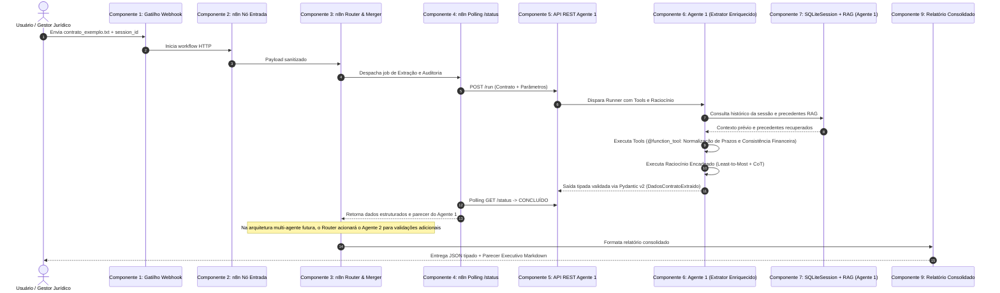

# Arquitetura do Sistema Multi-Agente (TP2)



Este documento detalha os **7 entregáveis de arquitetura da segunda entrega (TP2)** do Projeto de Bloco, especificando o gatilho, as fontes de dados, os 9 componentes da solução, o fluxo de dados passo a passo e o modelo de dados estruturados.

> [!NOTE]
> **Delimitação de Escopo do TP2:** A orquestração via **n8n** e o **Agente 2 (Avaliador de Risco)** constituem a **especificação arquitetural** planejada para implementação nas próximas etapas do Projeto de Bloco. No escopo do presente TP (TP2), toda a **implementação prática em código** está concentrada no **Agente 1 (Extrator Enriquecido)** em Python, dotando-o de ferramentas externas (`@function_tool`), raciocínio em etapas (*Least-to-Most* e *CoT*), persistência de memória (`SQLiteSession` + RAG) e saídas tipadas via Pydantic v2.

---

## 🎯 Tabela de Mapeamento dos Entregáveis do TP2

| # | Entregável | Definição no Projeto | Implementação / Artefato |
| :-: | :--- | :--- | :--- |
| **1** | **Qual Gatilho n8n** | Webhook HTTP / Chatbot Web / Telegram | Nó de Entrada n8n (`Webhook Trigger`) recebendo requisições com o documento contratual |
| **2** | **Fonte de Informações** | • Não Estruturada: Minuta Contratual em texto bruto<br/>• Estruturada: Banco Vetorial de Precedentes, Prazos ISO e Consistência Financeira | • `agent/contrato_exemplo.txt`<br/>• `agent/tools.py` e `agent/memoria_rag.py` |
| **3** | **Diagrama de Arquitetura** | Imagem formal com os 9 componentes interligados | `diagrama.png` (incorporado acima) e Mermaid code |
| **4** | **Descrição Textual da Arquitetura** | Responsabilidade detalhada de cada um dos 9 componentes | Seção 3 deste documento |
| **5** | **Exemplo do Fluxo de Dados** | Jornada passo a passo da entrada até a entrega do parecer | Seção 4 deste documento |
| **6** | **Dado Estruturado** | Informações armazenadas em DB (`SQLiteSession`, RAG vetorial) e consultadas via API/Pydantic | Seção 5 deste documento |
| **7** | **Demais Itens do TP2** | Tools `@function_tool`, Raciocínio Encadeado (CoT), Memória Persistente, Saídas Pydantic e Avaliação A/B (PRRR) | Detalhados no `RELATORIO_TECNICO.md` e pasta `agent/` |

---

## ⚡ 1. Gatilho do Workflow (n8n Trigger)

O fluxo é iniciado através de um **Webhook HTTP do n8n** (com suporte alternativo a bots de **Telegram** e **Chatbot Web** corporativo):
- **Método:** `POST /webhook/auditar-contrato`
- **Payload Recebido:**
  ```json
  {
    "session_id": "sessao_auditoria_techsolutions_01",
    "usuario": "diretoria_juridica",
    "texto_contrato": "CONTRATO DE PRESTAÇÃO DE SERVIÇOS DE DESENVOLVIMENTO DE INTELIGÊNCIA ARTIFICIAL...",
    "tipo_contrato": "desenvolvimento_ia"
  }
  ```
- **Comportamento:** O nó valida a presença do texto e despacha a requisição para o agente orquestrador central.

---

## 📚 2. Fontes de Informações (Obrigatório: Ambas Presentes)

### 2.1 Informação Não Estruturada (Documental)
- **Minuta Contratual em Texto Livre (`agent/contrato_exemplo.txt`):** Instrumento particular de prestação de serviços com cláusulas dissertativas, valores por extenso, datas, obrigações e disposições de rescisão imotivada.
- **Natureza:** Texto livre, com ambiguidades jurídicas e redação humana que exige interpretação por LLMs.

### 2.2 Informação Estruturada (Bancos de Dados & Módulos)
- **Normalização Temporal e Calendário (Tool `normalizar_prazos_e_datas`):** Módulo determinístico de cálculo de datas e dias corridos no padrão internacional ISO-8601.
- **Cronograma Financeiro e Tabela de Liquidação (Tool `extrair_e_validar_tabela_financeira`):** Verificação algorítmica de consistência matemática entre valor global e parcelas.
- **Banco Vetorial de Precedentes (Vector Store SQLite):** Precedentes contratuais corporativos indexados com embeddings de 1536 dimensões (`text-embedding-3-small`) contendo termos aditivos anteriores.

---

## 🏛️ 3. Descrição Textual dos 9 Componentes da Arquitetura

Conforme ilustrado em `diagrama.png`:

### 🔹 Componente 1: Gatilho de Entrada (Trigger)
- **Responsabilidade:** Ponto de contato inicial do usuário externo (via Webhook REST, Web App ou mensageria Telegram), capturando a solicitação de auditoria e submetendo os dados brutos ao pipeline.

### 🔹 Componente 2: Nó de Entrada do n8n (Recebimento e Parsing)
- **Responsabilidade:** Recebe o payload do Webhook, executa o parsing dos campos de entrada, sanitiza o texto do contrato, gera ou recupera o identificador da sessão (`session_id`) e direciona ao orquestrador.

### 🔹 Componente 3: Terceiro Agente n8n (Router & Merger)
- **Responsabilidade:** Agente inteligente orquestrador interno do n8n. Decide a sequência operacional de execução, aciona os agentes especialistas em background e, ao final, realiza a unificação (*merge*) estruturada dos dados extraídos e dos pareceres de risco.

### 🔹 Componente 4: Módulo de Chamadas Assíncronas (Background Tasks & Polling)
- **Responsabilidade:** Mecanismo de orquestração assíncrona do n8n para processos de longa duração (*long-running*). Envia a ordem de processamento via `POST /run` e consulta o endpoint `GET /status` em intervalos periódicos, evitando bloqueios ou timeouts HTTP.

### 🔹 Componente 5: API REST dos Agentes (Endpoints `/run` e `/status`)
- **Responsabilidade:** Camada de interface HTTP dos microserviços Python. Desacopla o orquestrador n8n do código de execução dos agentes, fornecendo contratos de API REST padronizados (`POST /run` para iniciar execução e `GET /status` para verificar progresso).

### 🔹 Componente 6: Agente 1: Extrator Enriquecido (Motor Python + LLM) — *Foco Deste TP2*
- **Responsabilidade:** O agente central desenvolvido e comprovado neste TP2 com o **OpenAI Agents SDK**. Ele é responsável por ler a minuta contratual, decompor a estrutura documental (*Least-to-Most* e *Chain-of-Thought*), acionar ferramentas externas (`@function_tool` de normalização temporal de datas e validação matemática financeira), acessar a memória persistente e RAG, e produzir saídas estruturadas validadas com Pydantic v2 (`DadosContratoExtraido`), prontas para serem consumidas no futuro pelo Agente 2.

### 🔹 Componente 7: Memória Persistente & RAG do Agente 1 (SQLiteSession & Vector DB)
- **Responsabilidade:** Dupla camada de retenção integrada diretamente ao **Agente 1**:
  1. `SQLiteSession`: Mantém o histórico conversacional e preferências do usuário entre execuções distintas.
  2. `Vector DB / RAG`: Base vetorial local com busca por similaridade de cosseno para recuperação de precedentes contratuais corporativos históricos.

### 🔹 Componente 8: Agente 2: Avaliador de Risco (Desenvolvimento Futuro)
- **Responsabilidade:** Componente planejado na arquitetura alvo do sistema multi-agente. Será desenvolvido na próxima etapa do projeto, atuando como um especialista desacoplado para auditorias jurídicas avançadas a partir dos dados já extraídos e estruturados pelo Agente 1.

### 🔹 Componente 9: Nó de Saída / Relatório Consolidado ao Usuário
- **Responsabilidade:** Camada de entrega que compila os metadados validados e o parecer executivo em formato Markdown e JSON estruturado, despachando o resultado ao usuário no canal de origem.

---

## 🔄 4. Exemplo do Fluxo de Dados Passo a Passo



---

## 💾 5. Dados Estruturados (Bancos de Dados & APIs)

### 5.1 Informações Armazenadas e Consultadas em Banco de Dados

1. **Tabela `sessoes_historico` (`agent/banco_memoria_contratos.db`):**
   - **Campos:** `id` (INTEGER PK AUTOINCREMENT), `session_id` (TEXT indexado), `item_data` (TEXT JSON) e `created_at` (TIMESTAMP).
   - **Conteúdo:** Mensagens serializadas de usuários e agentes que sustentam o estado da conversa e diretrizes corporativas entre diferentes invocações.

2. **Tabela `precedentes_contratuais` (Vector Store RAG):**
   - **Campos:** `documento_id` (TEXT PK), `titulo` (TEXT), `conteudo` (TEXT) e `embedding_json` (TEXT com 1536 floats).
   - **Conteúdo:** Vetores numéricos (1536 dimensões) derivados do modelo `text-embedding-3-small` para busca por proximidade angular (similaridade de cosseno).

### 5.2 Schemas Tipados com Pydantic v2 (APIs e Retornos)

- **`DadosContratoExtraido`:**
  - `titulo: str`
  - `contratante: ParteContratante` (nome, CNPJ formatado)
  - `contratada: ParteContratante` (nome, CNPJ formatado)
  - `objeto: str`
  - `financeiro: CronogramaFinanceiro` (valor global, parcelas, consistência matemática)
  - `vigencia: PeriodoVigencia` (datas ISO-8601, meses de vigência, dias corridos)
  - `penalidades: ClausulaPenal` (percentual de multa, base de cálculo e gatilho)

---

## 📋 6. Relação com os Demais Itens do TP2

Todas as implementações de código do projeto suportam diretamente a arquitetura aqui apresentada:
- **Tools Python:** [`agent/tools.py`](agent/tools.py) provê as ferramentas conectadas diretamente ao **Agente 1**.
- **Raciocínio Encadeado:** [`agent/pipeline_raciocinio.py`](agent/pipeline_raciocinio.py) implementa a decomposição Least-to-Most e CoT no **Agente 1**.
- **Memória & RAG:** [`agent/memoria_rag.py`](agent/memoria_rag.py) operacionaliza a `SQLiteSession` e a busca semântica vetorial do **Agente 1** (Componente 7).
- **Saídas Validadas:** [`agent/demo_saida_tipada.py`](agent/demo_saida_tipada.py) valida os schemas Pydantic v2 emitidos pelo **Agente 1**.
- **Avaliação A/B e PRRR:** [`evaluation/comparativo_variantes_prrr.md`](evaluation/comparativo_variantes_prrr.md) documenta o ganho de qualidade (+400% no IGQ) obtido nesta entrega.