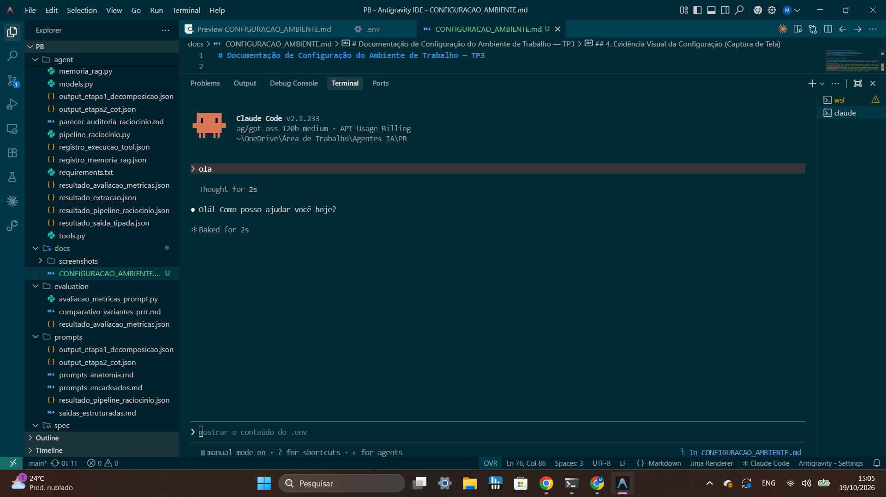

# Documentação de Configuração do Ambiente de Trabalho — TP3

**Projeto:** Sistema Multi-Agente de Análise e Auditoria de Contratos  
**Ambiente de Desenvolvimento:** Antigravity IDE + Claude Code CLI Integrado  
**Autora:** Maria Eduarda Mendes  
**Repositório:** `MariaEduardaMendes/agente-analise-de-contratos`  

---

## 1. Alternativa Escolhida e Justificativa

Para o desenvolvimento do TP3, foi adotada a integração do **Antigravity IDE com o Claude Code CLI operando diretamente no terminal integrado** (com suporte de roteamento flexível via **9Router** para aproveitamento de cotas do Google AI Pro e chaves de API).

### Justificativa Técnica:
1. **Produtividade e Baixa Fricção:** O Antigravity fornece navegação de arquivos, visualização de diffs, visualizador de artefatos Markdown/Mermaid e execução de testes em tempo real, enquanto o Claude Code atua diretamente no terminal PowerShell integrado com acesso imediato ao contexto do projeto.
2. **Context Engineering Nativo:** O Claude Code CLI lê automaticamente o arquivo `CLAUDE.md` na raiz do repositório ao ser iniciado, operando com total aderência às diretrizes arquiteturais e ao contexto do sistema.
3. **Fluxo Sequencial e Seguro:** A separação clara entre a interface de edição visual (Antigravity) e a interação conversacional/executiva (Claude Code CLI no terminal) elimina conflitos de escrita concorrente em arquivos.

---

## 2. Especificações do Ambiente

| Componente | Versão / Detalhes | Localização / Detalhes |
| :--- | :--- | :--- |
| **Ambiente de Desenvolvimento** | Antigravity IDE | Windows 11 (`C:\Users\dudap\.gemini\antigravity-ide`) |
| **Agente de Código CLI** | Claude Code v2.1.233 | `C:\Users\dudap\AppData\Roaming\npm\claude.ps1` |
| **Node.js Runtime** | v24.15.0 | Suporte ao ecossistema npm e CLI tools |
| **Python Runtime & Venv** | Python 3.14 (`.venv`) | FastAPI, Uvicorn, Pydantic v2, OpenAI Agents SDK |
| **Roteador Opcional** | 9Router CLI | `C:\Users\dudap\AppData\Roaming\npm\9router.ps1` |
| **Shell do Terminal** | PowerShell 7 / Windows PowerShell | Terminal Integrado do Antigravity |

---

## 3. Principais Passos Executados na Configuração

### Passo 1: Instalação e Verificação do Claude Code CLI
O Claude Code foi instalado globalmente no sistema através do gerenciador de pacotes npm:
```bash
npm install -g @anthropic-ai/claude-code
```
A verificação foi executada no terminal integrado:
```powershell
claude --version
# Retorno confirmado: 2.1.233 (Claude Code)
```

### Passo 2: Conexão do Claude Code com o 9Router Local (Google AI Pro / Free Providers)
O serviço **9Router** opera localmente na porta `20128` intermediando chamadas para provedores de IA sem consumir créditos adicionais:

1. **Definição de Variáveis no Terminal PowerShell:**
   ```powershell
   $env:ANTHROPIC_BASE_URL = "http://localhost:20128/v1"
   $env:ANTHROPIC_MODEL = "ag/gpt-oss-120b-medium"
   # ANTHROPIC_API_KEY carregada automaticamente a partir do .env
   ```
2. **Persistência no Arquivo `.env`:** As credenciais e configurações de roteamento foram registradas no arquivo `.env` do projeto para carregamento automático.
3. **Inicialização Direta:**
   ```powershell
   claude
   ```


### Passo 3: Context Engineering Descentralizado via `CLAUDE.md`
Em estrita conformidade com as diretrizes do TP3, **não foi mantido um `CLAUDE.md` unificado na raiz** para evitar que os dois agentes fossem tratados como um sistema monolítico acoplado. Em vez disso, o contexto foi descentralizado:
- **`agent1/CLAUDE.md`**: Delimita a responsabilidade exclusiva de extração documental, normalização temporal de datas e consistência de parcelas.
- **`agent2/CLAUDE.md`**: Delimita a responsabilidade exclusiva de auditoria corporativa, conformidade de alçadas e cálculo de risco.
- Ao abrir o Claude Code dentro de cada pasta específica, o agente de código assume o papel e as regras daquele microsserviço isoladamente.


### Passo 4: Execução e Validação no Terminal Integrado do Antigravity
Dentro do terminal integrado do Antigravity, na raiz do repositório `agente-analise-de-contratos`, foi disparado o agente de código:
```powershell
claude
```
O agente inicializou com sucesso, identificou o contexto do repositório, leu o `CLAUDE.md` e ficou pronto para atender comandos de scaffolding e codificação.

---

## 4. Evidência Visual da Configuração (Captura de Tela)

Abaixo encontra-se a captura de tela que demonstra o ecossistema integrado em pleno funcionamento no contexto do projeto:



### Elementos em Destaque na Captura:
1. **Painel Esquerdo (Workspace):** Estrutura de pastas do projeto aberta no Antigravity (`agent/`, `docs/`, `CLAUDE.md`, `.env`).
2. **Editor Central:** Arquivo de contexto `CLAUDE.md` ou documentação do projeto aberta.
3. **Terminal Integrado (Inferior):** Claude Code CLI ativo e conectado na pasta do projeto, demonstrando a versão e o prompt de interação do agente.

---

## 5. Boas Práticas Adotadas para Evitar Conflitos de Edição

Conforme orientado no TP3, foi instituído o seguinte protocolo de trabalho sequencial:
1. **Fase de Concepção e Arquitetura:** Modelagem no Antigravity com visualização em tempo real de Markdown e diagramas.
2. **Fase de Escrita de Código:** Execução de tarefas no Claude Code via terminal integrado ou assistência pair-programming no Antigravity, salvando e commitando incrementalmente.
3. **Fase de Validação e Teste:** Execução dos serviços FastAPI no terminal e validação dos endpoints via `curl` / Swagger `/docs`.
